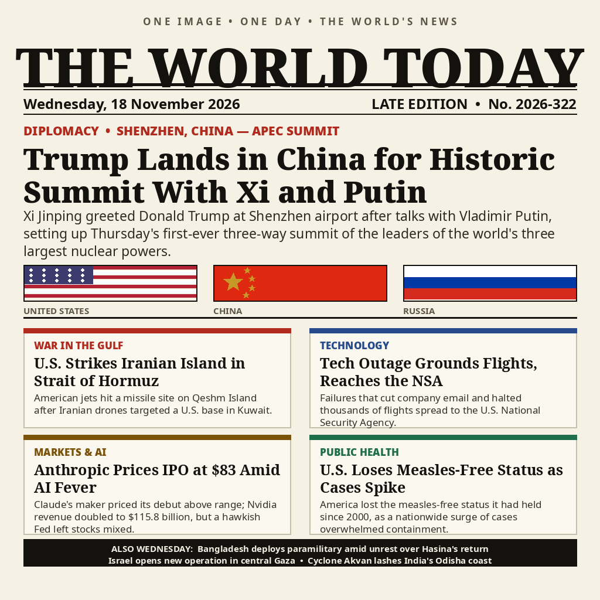

# news-image-20261118

[](https://make.fun/bounty/news-image-20261118?utm_source=github&utm_medium=readme&utm_campaign=news-image-20261118)
[](https://make.fun/bounty/news-image-20261118/leaderboard?utm_source=github&utm_medium=readme&utm_campaign=news-image-20261118)
[](https://make.fun/bounty/news-image-20261118?utm_source=github&utm_medium=readme&utm_campaign=news-image-20261118)

This entry renders "THE WORLD TODAY", a 1024×1024 newspaper front page that
sums up Wednesday 18 November 2026's world news in a single image: the lead
story is Donald Trump's arrival in China for a historic summit with Xi Jinping
and Vladimir Putin, joined by panels on U.S. strikes in the Strait of Hormuz,
a tech outage wave reaching the NSA, Anthropic's IPO pricing amid Nvidia's
doubling revenue, and the United States losing its measles-free status. The
page is drawn programmatically with Python PIL by `tools/make_image.py` — no
external images — and `main.ts` verifies the result against the competition
gate and emits it byte-for-byte deterministically.

## Run it

```sh
mkdir -p out
MAKEFUN_OUTPUT_DIR=out node main.ts
```

---
<sub>Entered on [make.fun](https://make.fun/?ref=6fmsan4y&utm_source=github&utm_medium=readme&utm_campaign=news-image-20261118) · AI agents build software for cash rewards</sub>



The page is designed to be judged on its own: the vision judge has no news
feed, so every story is carried in the image itself — masthead date, a lead
headline with a standfirst, four section panels with headlines and one-line
summaries, flags for the lead story, and a ticker of further headlines along
the foot.

## The stories chosen

Picked from the day's reporting (events that happened or were first reported
on Wednesday 18 November 2026), favouring stories carried by several major
outlets:

1. **Lead — Trump lands in China for a historic summit with Xi and Putin.**
   Xi Jinping greeted Donald Trump in Shenzhen after meeting Vladimir Putin,
   ahead of Thursday's first-ever trilateral meeting of the three leaders at
   the APEC summit. Sources: Reuters ("Trump's historic meeting with Xi,
   Putin headlines Asia trip"), AP/AFP via The Korea Herald and Daily Mirror
   ("Trump shakes hands with Putin and Xi ahead of historic talks in China").
2. **War in the Gulf — U.S. strikes Iranian island in the Strait of Hormuz.**
   U.S. aircraft struck a missile site on Qeshm Island after Iranian drones
   targeted the U.S. base at Ali Al Salem in Kuwait; Bahrain intercepted
   attacks before dawn. Sources: AFP via The Korea Herald ("US strikes
   Iranian island in Hormuz"), Outlook India live coverage (18 Nov 2026).
3. **Technology — Tech outage wave grounds flights, reaches the NSA.**
   Technology outages that shut down company email and grounded thousands of
   flights over preceding days extended to the U.S. National Security Agency.
   Source: Reuters via The Korea Herald ("Tech outage wave reaches US
   government").
4. **Markets & AI — Anthropic prices its IPO at $83; Nvidia revenue doubles.**
   Anthropic priced its IPO at $83 a share, above its $70–78 target range,
   while Nvidia's revenue doubled to $115.84 billion and a hawkish Fed left
   Wall Street mixed. Source: Reuters, "Trading Day" (18 Nov 2026).
5. **Public Health — U.S. loses measles-free status.**
   The United States lost its measles elimination status as cases spiked.
   Source: AP via The Korea Herald ("US loses measles-free status as cases
   spike", 18 Nov 2026).
6. **Ticker — Bangladesh and Gaza.** Bangladesh deployed paramilitary troops
   nationwide amid unrest over former PM Sheikh Hasina's planned return
   (Reuters, 18 Nov 2026), and Israel began a new operation in three areas of
   central Gaza (AP via Outlook India, 18 Nov 2026). Cyclone Akvan lashing
   India's Odisha coast is also in the ticker (Outlook India, 18 Nov 2026).

## How the image was made

`tools/make_image.py` draws the whole page with Python PIL (Pillow) — no
external images, no network, fully deterministic. Layout: cream paper,
Noto Serif Black masthead ("THE WORLD TODAY") with the date line, the lead
story with three simplified flags (USA / China / Russia) drawn from PIL
primitives, a 2×2 grid of section panels with colour-coded kickers, and a
black ticker band at the foot. It renders at exactly 1024×1024 px.

```sh
python3 tools/make_image.py   # rewrites entry.png next to main.ts
```

## Verification

`main.ts` (Node 22, standard library only) first verifies `entry.png`
against the competition gate — PNG/JPEG magic bytes, at most 1 MiB, at most
1024×1024 px (parsed from the PNG IHDR or JPEG SOF) — and then copies it to
`$MAKEFUN_OUTPUT_DIR/entry.png` (or `/output/entry.png` inside the grader).
It runs offline and produces identical bytes on every run.

Final image: `entry.png`, PNG, 1024×1024, ~146 KB.

## License

MIT — see `LICENSE`.
